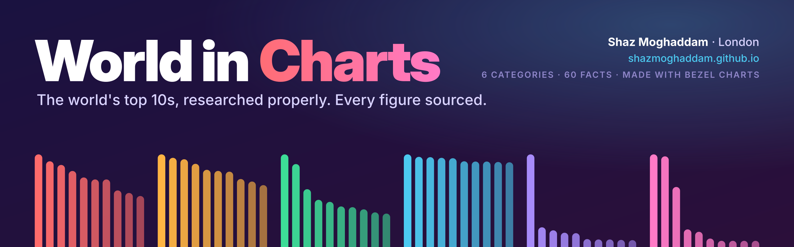
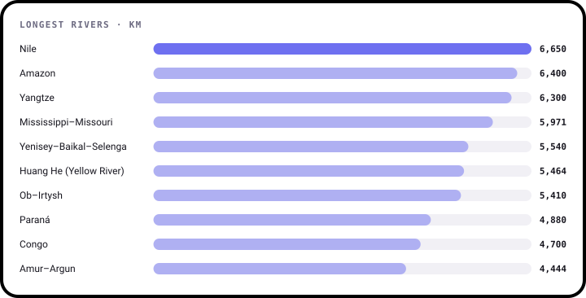
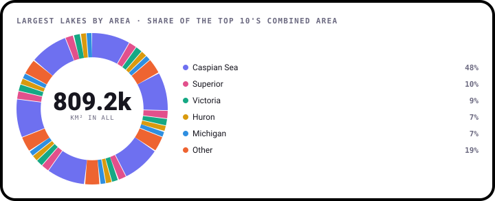

<a href="https://shazmoghaddam.github.io/"></a>

# World in Charts

**The world's top 10s, researched properly and drawn with [Bezel Charts](https://github.com/ShazMoghaddam/bezel-charts).**

[](LICENSE)
[](https://github.com/ShazMoghaddam/bezel-charts)

Most "top 10" lists online copy each other, mix up measurements and state guesses as facts. This repo does the opposite. Every figure has a source, every ranking says exactly how it was measured, and every entry is marked by how sure we can be about it.

## How sure is each figure?

| Label | Means |
| --- | --- |
| **Verified** | Counted or measured directly and confirmed, such as a full tree-ring count. |
| **Measured** | Measured by a recognised authority, but the answer depends on method, such as where a river's source is drawn. |
| **Estimated** | A reasoned estimate that hasn't been directly measured, such as a tree's age from its girth. |
| **Disputed** | Credible sources disagree, or the evidence can't be rechecked. |

Where a source gives a range, the lower end is used for ranking, so nothing is overstated.

## Contents

**Nature**

- [Oldest living individual trees](#oldest-living-individual-trees)
- [Longest rivers](#longest-rivers)
- [Deepest lakes](#deepest-lakes)
- [Highest mountains](#highest-mountains)
- [Largest lakes by area](#largest-lakes-by-area)
- [Largest deserts](#largest-deserts)

More categories are on the way: waterfalls, volcanoes, ocean trenches, caves, islands, craters, glaciers, reefs, record temperatures, animals, and human-made records such as buildings, bridges and cities.

## Oldest living individual trees


**Measured as:** age in years as of 2026, for single-trunk trees that are still alive. Clonal trees such as Sweden's Old Tjikko are left out, because their roots are ancient but their trunks are only a few hundred years old.

**Why this chart:** stacked bars split each age into the part that was ring-counted (solid) and the part that is only estimated (striped). It shows at a glance that most of these famous ages are educated guesses.

| # | Tree | Where | Type | Age (years) | How sure |
| --- | --- | --- | --- | --- | --- |
| 1 | Gran Abuelo (Alerce Milenario) | Los Ríos, Chile | Patagonian cypress | 5,484 | Disputed |
| 2 | Unnamed bristlecone (Schulman tree) | White Mountains, California, USA | Great Basin bristlecone pine | 5,075 | Disputed |
| 3 | Methuselah | White Mountains, California, USA | Great Basin bristlecone pine | 4,858 | Verified |
| 4 | Sarv-e Abarkuh | Abarkuh, Yazd, Iran | Mediterranean cypress | 4,500 | Estimated |
| 5 | Gümeli Porsuğu | Zonguldak, Turkey | Yew | 4,115 | Estimated |
| 6 | Llangernyw Yew | Llangernyw, Conwy, Wales, UK | Common yew | 4,000 to 5,000 | Estimated |
| 7 | The Ancient Yew of Tisbury | Tisbury, Wiltshire, England, UK | Common yew | 4,000 | Estimated |
| 8 | Oliveira do Mouchão | Mouriscas, Abrantes, Portugal | Olive | 3,350 | Estimated |
| 9 | The President | Sierra Nevada, California, USA | Giant sequoia | 3,200 | Estimated |
| 10 | Patriarca da Floresta | Santa Rita do Passa Quatro, São Paulo, Brazil | Jequitibá-rosa | 3,020 | Estimated |

**Notes**

- **Gran Abuelo:** 3,655 years is a ring-counted minimum from an incomplete core. The 5,484 figure is a 2022 statistical model by climatologist Jonathan Barichivich, who gives an 80% chance that the tree is over 5,000. Other scientists say only a full ring count can settle it.
- **The Schulman tree:** dated to about 3050 BCE by the Rocky Mountain Tree-Ring Research OldList, but its core is missing, so the age can't be rechecked.
- **Methuselah:** ring-counted in 1957, germinating around 2833 BCE. It is the oldest living tree with a confirmed age, though one later study couldn't reproduce the count and estimated about 4,666 years.

**Sources:** [Rocky Mountain Tree-Ring Research OldList](https://web.archive.org/web/20130412091010/http://www.rmtrr.org/oldlist.htm) · [Wikipedia: List of oldest trees](https://en.wikipedia.org/wiki/List_of_oldest_trees) · [Wikipedia: Methuselah](https://en.wikipedia.org/wiki/Methuselah_(pine_tree)) · [Live Science (2022)](https://www.livescience.com/planet-earth/plants/the-oldest-tree-in-the-world-and-the-7-runner-ups)

## Longest rivers



**Measured as:** length in km from the most distant source to the mouth, following the longest chain of tributaries. All ten figures come from one source, Britannica, so they are measured the same way.

**Why this chart:** plain ranked bars. One measure, one source, so the lengths compare directly.

| # | River | Where | Length (km) | How sure |
| --- | --- | --- | --- | --- |
| 1 | Nile | Northeast Africa, 11 countries, mouth in Egypt | 6,650 | Disputed |
| 2 | Amazon | South America: Peru, Colombia, Brazil | 6,400 | Disputed |
| 3 | Yangtze | China | 6,300 | Measured |
| 4 | Mississippi–Missouri | USA, Canada | 5,971 | Measured |
| 5 | Yenisey–Baikal–Selenga | Mongolia, Russia | 5,540 | Measured |
| 6 | Huang He (Yellow River) | China | 5,464 | Measured |
| 7 | Ob–Irtysh | China, Kazakhstan, Russia | 5,410 | Measured |
| 8 | Paraná | Brazil, Paraguay, Argentina | 4,880 | Measured |
| 9 | Congo | DR Congo, Republic of the Congo, Angola | 4,700 | Measured |
| 10 | Amur–Argun | China, Russia | 4,444 | Measured |

**Notes**

- **Nile or Amazon?** The Nile is the usual answer, but surveys that trace the Amazon from a more distant source in Peru make it longer. Both are marked disputed.
- **Mississippi–Missouri:** Britannica measures it from the Red Rock source of the Missouri. Other sources give up to 6,275 km.
- River lengths depend on where the source and mouth are drawn, so most carry an uncertainty of a few per cent.

**Source:** [Britannica: World's longest rivers](https://www.britannica.com/topic/worlds-longest-rivers-2225894)

## Deepest lakes


**Measured as:** maximum depth in metres, from the surface to the deepest known point. Ranked by maximum depth, not average depth. Where the lake's managing body has published a survey, that figure is used.

**Why this chart:** bars hang down from the surface, like the lakes themselves, so the deepest lake reaches furthest.

| # | Lake | Where | Max depth (m) | How sure |
| --- | --- | --- | --- | --- |
| 1 | Baikal | Southern Siberia, Russia | 1,642 | Verified |
| 2 | Tanganyika | Tanzania, DR Congo, Burundi, Zambia | 1,470 | Measured |
| 3 | Caspian Sea | Kazakhstan, Turkmenistan, Azerbaijan, Russia, Iran | 1,025 | Measured |
| 4 | O'Higgins / San Martín | Patagonia, Chile and Argentina | 836 | Measured |
| 5 | Vostok | Under the East Antarctic Ice Sheet | about 800 | Estimated |
| 6 | Argentino | Santa Cruz Province, Argentina | 719 | Measured |
| 7 | Malawi | Malawi, Mozambique, Tanzania | 706 | Measured |
| 8 | Issyk-Kul | Tian Shan mountains, Kyrgyzstan | 668 | Measured |
| 9 | Great Slave | Northwest Territories, Canada | 614 | Measured |
| 10 | Crater Lake | Oregon, USA | 592 | Verified |

**Notes**

- **Caspian Sea:** called a sea, but geographers and limnologists generally class it as a huge inland salt lake.
- **Baikal:** Guinness World Records lists the same 1,642 m.
- **Vostok:** sealed under about 4 km of Antarctic ice. Seismic mapping by Columbia University's Lamont-Doherty Earth Observatory found about 800 m of water in its southern basin and about 400 m in the northern one. Published estimates of its deepest point range from 510 m to 900 m.
- **Argentino:** not in the National Park Service list or many older top 10s, but included in Wikipedia's current list.
- **Crater Lake:** measured with multibeam sonar in 2000. Some lists give 594 m.
- **Just missing out:** Lake Matano in Indonesia, at 590 m, is only 2 m behind Crater Lake.

**Sources:** [Guinness World Records: Deepest lake](https://www.guinnessworldrecords.com/world-records/deepest-lake) · [US National Park Service: Crater Lake](https://www.nps.gov/places/crater-lake.htm) · [US National Park Service: The World's Deepest Lakes](https://www.nps.gov/crla/planyourvisit/upload/World-s-Deepest-Lakes-2017-508.pdf) · [Christner and Priscu: Subglacial Lake Vostok](https://www.montana.edu/priscu/documents/Publications/ChristnerPriscu2005SubglacialVostok.pdf) · [Wikipedia: List of lakes by depth](https://en.wikipedia.org/wiki/List_of_lakes_by_depth)

## Highest mountains


**Measured as:** height of the summit above sea level, in metres. **Prominence** is how far a summit rises above the lowest point you'd have to cross to reach a higher one.

**Why this chart:** on height alone, all ten sit between 8,091 and 8,849 m and look almost the same. Prominence beside each one shows which peaks really stand alone and which are shoulders of a bigger neighbour.

| # | Mountain | Where | Height (m) | Prominence (m) | How sure |
| --- | --- | --- | --- | --- | --- |
| 1 | Everest | Nepal, China | 8,849 | 8,849 | Verified |
| 2 | K2 | Pakistan, China | 8,611 | 4,020 | Measured |
| 3 | Kangchenjunga | Nepal, India | 8,586 | 3,922 | Measured |
| 4 | Lhotse | Nepal, China | 8,516 | 610 | Measured |
| 5 | Makalu | Nepal, China | 8,485 | 2,378 | Measured |
| 6 | Cho Oyu | Nepal, China | 8,188 | 2,340 | Measured |
| 7 | Dhaulagiri I | Nepal | 8,167 | 3,357 | Measured |
| 8 | Manaslu | Nepal | 8,163 | 3,092 | Measured |
| 9 | Nanga Parbat | Pakistan | 8,126 | 4,608 | Measured |
| 10 | Annapurna I | Nepal | 8,091 | 2,984 | Measured |

**Notes**

- **Everest:** 8,848.86 m, announced jointly by China and Nepal on 8 December 2020 from GPS and trigonometric surveys by both countries' teams in 2019 and 2020. It's the snow height, 86 cm above the old 8,848 m figure. As the highest point on Earth, its prominence equals its height.
- **Lhotse:** fourth highest, but joined to Everest by the South Col and only 610 m above it, so it's barely a separate mountain.
- **Nanga Parbat:** ninth by height, but after Everest the most prominent peak in the top 10, standing almost alone at the western end of the Himalaya.
- **Small disagreements:** surveys differ by a few metres for some peaks, such as Cho Oyu (8,188 or 8,201 m) and Makalu (8,485 or 8,481 m). None of them change the order.

**Sources:** [Al Jazeera: Nepal and China announce Everest's new height (2020)](https://www.aljazeera.com/news/2020/12/8/mt-everest-nepal-china-announce-revised-height-at-8848-metres) · [Wikipedia: List of highest mountains](https://en.wikipedia.org/wiki/List_of_highest_mountains_on_Earth) (checked against the March 2026 version)

## Largest lakes by area



**Measured as:** surface area in km². All ten figures come from one source, Britannica, so they are measured the same way.

**Why this chart:** a donut shows how the top 10's combined surface splits. The Caspian Sea alone is almost half of it. The five smallest lakes in the top 10 are grouped as "Other"; the table has each one.

| # | Lake | Where | Area (km²) | How sure |
| --- | --- | --- | --- | --- |
| 1 | Caspian Sea | Kazakhstan, Turkmenistan, Iran, Azerbaijan, Russia | 386,400 | Measured |
| 2 | Superior | Canada, USA | 82,100 | Measured |
| 3 | Victoria | Uganda, Kenya, Tanzania | 69,484 | Measured |
| 4 | Huron | Canada, USA | 59,570 | Measured |
| 5 | Michigan | USA | 57,757 | Measured |
| 6 | Tanganyika | Tanzania, DR Congo, Burundi, Zambia | 32,900 | Measured |
| 7 | Baikal | Russia | 31,500 | Measured |
| 8 | Great Bear | Northwest Territories, Canada | 31,328 | Measured |
| 9 | Malawi (Nyasa) | Malawi, Mozambique, Tanzania | 29,604 | Measured |
| 10 | Great Slave | Northwest Territories, Canada | 28,568 | Measured |

**Notes**

- **Caspian Sea:** called a sea, but classed as a lake because it's landlocked. Its water level is falling, so its area is shrinking; other sources give 371,000 km².
- **Victoria:** some sources give as little as 59,947 km², depending on where its swampy margins are counted.
- **Michigan and Huron:** joined at the Straits of Mackinac. Counted as one lake, Michigan–Huron would be the largest freshwater lake, at about 117,000 km².
- **Baikal:** only seventh by area, but the largest freshwater lake by volume because it's so deep.

**Source:** [Britannica: World's largest lakes](https://www.britannica.com/topic/worlds-largest-lakes-2228655)

## Largest deserts


**Measured as:** area in km². A desert is any region that gets very little rain or snow, usually under 250 mm a year, so the ice of Antarctica and the Arctic counts.

**Why this chart:** ranked bars, with colour and pattern showing the type of desert. The two biggest deserts on Earth are ice, and the Sahara is "only" third.

| # | Desert | Type | Where | Area (km²) | How sure |
| --- | --- | --- | --- | --- | --- |
| 1 | Antarctic | Polar | Antarctica | 14,200,000 | Measured |
| 2 | Arctic | Polar | Canada, Greenland, Russia, Norway, USA and others | 13,900,000 | Estimated |
| 3 | Sahara | Hot | North Africa | 9,200,000 | Estimated |
| 4 | Great Australian | Hot | Australia | 2,700,000 | Disputed |
| 5 | Arabian | Hot | Arabian Peninsula | 2,330,000 | Estimated |
| 6 | Gobi | Cold winter | China, Mongolia | 1,295,000 | Estimated |
| 7 | Kalahari | Hot | Botswana, Namibia, South Africa | 900,000 | Estimated |
| 8 | Patagonian | Cold winter | Argentina, Chile | 673,000 | Estimated |
| 9 | Syrian | Hot | Syria, Jordan, Iraq, Saudi Arabia | 500,000 | Estimated |
| 10 | Great Basin | Cold winter | USA | 492,098 | Estimated |

**Notes**

- **Why most are estimates:** desert edges are blurry, so apart from Antarctica, which is a whole continent, sources draw them differently and their areas differ, sometimes by a lot.
- **Great Australian:** not one desert but a group of ten, including the Great Victoria, Great Sandy and Gibson. Wikipedia counts them together; most top 10 lists count them separately, and then none of them make the top 10.
- **Kalahari:** gets enough rain in places to be called a semi-desert.
- **Just missing out:** the Chihuahuan Desert in Mexico and the USA, at 453,248 km².

**Source:** [Wikipedia: List of deserts by area](https://en.wikipedia.org/wiki/List_of_deserts_by_area)

## How it works

```
data/      one JSON file per category: every entry, its source, how sure it is, and a note
scripts/   build.mjs draws each chart from its data file with Bezel Charts
           banner.mjs draws the banner and social preview from the same data
charts/    the finished SVGs shown in this README
assets/    the banner and social preview
```

The bars along the bottom of the banner are the real figures, one colour per category, so the banner grows as categories are added. To redraw it, run `npm run banner`, then turn the SVGs into PNGs (on a Mac: `brew install librsvg`, then `rsvg-convert -w 2560 assets/banner.svg -o assets/banner.png` and `rsvg-convert -w 1280 assets/social-preview.svg -o assets/social-preview.png`).

To redraw the charts after changing the data:

```sh
npm install
npm run build
```

Each data file says how its ranking is measured and when it was last checked, so the data can be reused anywhere, not just here.

## Spotted a mistake?

Accuracy is the whole point, so corrections are very welcome. See [CONTRIBUTING.md](CONTRIBUTING.md). Please include a source.

## Licence

[MIT](LICENSE). The facts themselves aren't owned by anyone; the sources are credited in each section.

---

Created by **Shaz Moghaddam** · London\
[Website](https://shazmoghaddam.github.io/) · [LinkedIn](https://www.linkedin.com/in/shazmoghaddam/)
