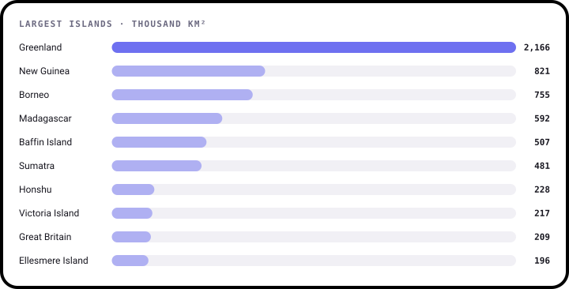
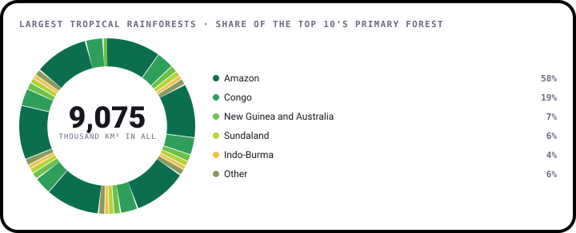

<a href="https://shazmoghaddam.github.io/"></a>

# World in Charts

**The world's top 10s, researched properly and drawn with [Bezel Charts](https://github.com/ShazMoghaddam/bezel-charts).**\
Developed by [Shaz Moghaddam](https://shazmoghaddam.github.io/).

[](LICENSE)
[](https://github.com/ShazMoghaddam/bezel-charts)
[](https://www.npmjs.com/package/bezel-charts)
[](https://github.com/ShazMoghaddam/world-in-charts/actions/workflows/check.yml)

Most "top 10" lists online copy each other, mix up measurements and state guesses as facts. This repo does the opposite. Every figure has a source, every ranking says exactly how it was measured, and every entry is marked by how sure we can be about it.

> [!IMPORTANT]
> **Researched in November 2026.** Every figure was checked against its sources at that time. The world keeps moving: new buildings go up, cavers map new passages, records get broken and better surveys replace old ones. So some of these numbers will change. Each data file records the date it was checked, and [corrections are welcome](CONTRIBUTING.md).

## How sure is each figure?

| Label | Means |
| --- | --- |
| **Verified** | Counted or measured directly and confirmed, such as a full tree-ring count. |
| **Measured** | Measured by a recognised authority, but the answer depends on method, such as where a river's source is drawn. |
| **Estimated** | A reasoned estimate that hasn't been directly measured, such as a tree's age from its girth. |
| **Disputed** | Credible sources disagree, or the evidence can't be rechecked. |

Where a source gives a range, the lower end is used for ranking, so nothing is overstated.

## Contents

**Nature**

- [Oldest living individual trees](#oldest-living-individual-trees)
- [Longest rivers](#longest-rivers)
- [Deepest lakes](#deepest-lakes)
- [Highest mountains](#highest-mountains)
- [Largest lakes by area](#largest-lakes-by-area)
- [Largest deserts](#largest-deserts)
- [Tallest waterfalls](#tallest-waterfalls)
- [Highest active volcanoes](#highest-active-volcanoes)
- [Deepest ocean trenches](#deepest-ocean-trenches)
- [Longest cave systems](#longest-cave-systems)
- [Largest islands](#largest-islands)
- [Tallest trees by species](#tallest-trees-by-species)
- [Largest tropical rainforests](#largest-tropical-rainforests)
- [Longest-living animals](#longest-living-animals)
- [Largest impact craters](#largest-impact-craters)
- [Deepest canyons](#deepest-canyons)
- [Countries with the most coral reef](#countries-with-the-most-coral-reef)
- [Temperature records by continent](#temperature-records-by-continent)

**Human-made**

- [Tallest buildings](#tallest-buildings)
- [Longest bridges](#longest-bridges)
- [Most visited museums](#most-visited-museums)

Still to come: largest glaciers and oldest cities, once reliable figures are confirmed.

## Oldest living individual trees


**Measured as:** age in years as of 2026, for single-trunk trees that are still alive. Clonal trees such as Sweden's Old Tjikko are left out, because their roots are ancient but their trunks are only a few hundred years old.

**Why this chart:** stacked bars split each age into the part that was ring-counted (solid) and the part that is only estimated (striped). It shows at a glance that most of these famous ages are educated guesses.

| # | Tree | Where | Type | Age (years) | How sure |
| --- | --- | --- | --- | --- | --- |
| 1 | Gran Abuelo (Alerce Milenario) | Los Ríos, Chile | Patagonian cypress | 5,484 | Disputed |
| 2 | Unnamed bristlecone (Schulman tree) | White Mountains, California, USA | Great Basin bristlecone pine | 5,075 | Disputed |
| 3 | Methuselah | White Mountains, California, USA | Great Basin bristlecone pine | 4,858 | Verified |
| 4 | Sarv-e Abarkuh | Abarkuh, Yazd, Iran | Mediterranean cypress | 4,500 | Estimated |
| 5 | Gümeli Porsuğu | Zonguldak, Turkey | Yew | 4,115 | Estimated |
| 6 | Llangernyw Yew | Llangernyw, Conwy, Wales, UK | Common yew | 4,000 to 5,000 | Estimated |
| 7 | The Ancient Yew of Tisbury | Tisbury, Wiltshire, England, UK | Common yew | 4,000 | Estimated |
| 8 | Oliveira do Mouchão | Mouriscas, Abrantes, Portugal | Olive | 3,350 | Estimated |
| 9 | The President | Sierra Nevada, California, USA | Giant sequoia | 3,200 | Estimated |
| 10 | Patriarca da Floresta | Santa Rita do Passa Quatro, São Paulo, Brazil | Jequitibá-rosa | 3,020 | Estimated |

**Notes**

- **Gran Abuelo:** 3,655 years is a ring-counted minimum from an incomplete core. The 5,484 figure is a 2022 statistical model by climatologist Jonathan Barichivich, who gives an 80% chance that the tree is over 5,000. Other scientists say only a full ring count can settle it.
- **The Schulman tree:** dated to about 3050 BCE by the Rocky Mountain Tree-Ring Research OldList, but its core is missing, so the age can't be rechecked.
- **Methuselah:** ring-counted in 1957, germinating around 2833 BCE. It is the oldest living tree with a confirmed age, though one later study couldn't reproduce the count and estimated about 4,666 years.

**Sources:** [Rocky Mountain Tree-Ring Research OldList](https://web.archive.org/web/20130412091010/http://www.rmtrr.org/oldlist.htm) · [Wikipedia: List of oldest trees](https://en.wikipedia.org/wiki/List_of_oldest_trees) · [Wikipedia: Methuselah](https://en.wikipedia.org/wiki/Methuselah_(pine_tree)) · [Live Science (2022)](https://www.livescience.com/planet-earth/plants/the-oldest-tree-in-the-world-and-the-7-runner-ups)

## Longest rivers


**Measured as:** length in km from the most distant source to the mouth, following the longest chain of tributaries. All ten figures come from one source, Britannica, so they are measured the same way.

**Why this chart:** plain ranked bars. One measure, one source, so the lengths compare directly.

| # | River | Where | Length (km) | How sure |
| --- | --- | --- | --- | --- |
| 1 | Nile | Northeast Africa, 11 countries, mouth in Egypt | 6,650 | Disputed |
| 2 | Amazon | South America: Peru, Colombia, Brazil | 6,400 | Disputed |
| 3 | Yangtze | China | 6,300 | Measured |
| 4 | Mississippi–Missouri | USA, Canada | 5,971 | Measured |
| 5 | Yenisey–Baikal–Selenga | Mongolia, Russia | 5,540 | Measured |
| 6 | Huang He (Yellow River) | China | 5,464 | Measured |
| 7 | Ob–Irtysh | China, Kazakhstan, Russia | 5,410 | Measured |
| 8 | Paraná | Brazil, Paraguay, Argentina | 4,880 | Measured |
| 9 | Congo | DR Congo, Republic of the Congo, Angola | 4,700 | Measured |
| 10 | Amur–Argun | China, Russia | 4,444 | Measured |

**Notes**

- **Nile or Amazon?** The Nile is the usual answer, but surveys that trace the Amazon from a more distant source in Peru make it longer. Both are marked disputed.
- **Mississippi–Missouri:** Britannica measures it from the Red Rock source of the Missouri. Other sources give up to 6,275 km.
- River lengths depend on where the source and mouth are drawn, so most carry an uncertainty of a few per cent.

**Source:** [Britannica: World's longest rivers](https://www.britannica.com/topic/worlds-longest-rivers-2225894)

## Deepest lakes


**Measured as:** maximum depth in metres, from the surface to the deepest known point. Ranked by maximum depth, not average depth. Where the lake's managing body has published a survey, that figure is used.

**Why this chart:** bars hang down from the surface, like the lakes themselves, so the deepest lake reaches furthest.

| # | Lake | Where | Max depth (m) | How sure |
| --- | --- | --- | --- | --- |
| 1 | Baikal | Southern Siberia, Russia | 1,642 | Verified |
| 2 | Tanganyika | Tanzania, DR Congo, Burundi, Zambia | 1,470 | Measured |
| 3 | Caspian Sea | Kazakhstan, Turkmenistan, Azerbaijan, Russia, Iran | 1,025 | Measured |
| 4 | O'Higgins / San Martín | Patagonia, Chile and Argentina | 836 | Measured |
| 5 | Vostok | Under the East Antarctic Ice Sheet | about 800 | Estimated |
| 6 | Argentino | Santa Cruz Province, Argentina | 719 | Measured |
| 7 | Malawi | Malawi, Mozambique, Tanzania | 706 | Measured |
| 8 | Issyk-Kul | Tian Shan mountains, Kyrgyzstan | 668 | Measured |
| 9 | Great Slave | Northwest Territories, Canada | 614 | Measured |
| 10 | Crater Lake | Oregon, USA | 592 | Verified |

**Notes**

- **Caspian Sea:** called a sea, but geographers and limnologists generally class it as a huge inland salt lake.
- **Baikal:** Guinness World Records lists the same 1,642 m.
- **Vostok:** sealed under about 4 km of Antarctic ice. Seismic mapping by Columbia University's Lamont-Doherty Earth Observatory found about 800 m of water in its southern basin and about 400 m in the northern one. Published estimates of its deepest point range from 510 m to 900 m.
- **Argentino:** not in the National Park Service list or many older top 10s, but included in Wikipedia's current list.
- **Crater Lake:** measured with multibeam sonar in 2000. Some lists give 594 m.
- **Just missing out:** Lake Matano in Indonesia, at 590 m, is only 2 m behind Crater Lake.

**Sources:** [Guinness World Records: Deepest lake](https://www.guinnessworldrecords.com/world-records/deepest-lake) · [US National Park Service: Crater Lake](https://www.nps.gov/places/crater-lake.htm) · [US National Park Service: The World's Deepest Lakes](https://www.nps.gov/crla/planyourvisit/upload/World-s-Deepest-Lakes-2017-508.pdf) · [Christner and Priscu: Subglacial Lake Vostok](https://www.montana.edu/priscu/documents/Publications/ChristnerPriscu2005SubglacialVostok.pdf) · [Wikipedia: List of lakes by depth](https://en.wikipedia.org/wiki/List_of_lakes_by_depth)

## Highest mountains


**Measured as:** height of the summit above sea level, in metres. **Prominence** is how far a summit rises above the lowest point you'd have to cross to reach a higher one.

**Why this chart:** on height alone, all ten sit between 8,091 and 8,849 m and look almost the same. Prominence beside each one shows which peaks really stand alone and which are shoulders of a bigger neighbour.

| # | Mountain | Where | Height (m) | Prominence (m) | How sure |
| --- | --- | --- | --- | --- | --- |
| 1 | Everest | Nepal, China | 8,849 | 8,849 | Verified |
| 2 | K2 | Pakistan, China | 8,611 | 4,020 | Measured |
| 3 | Kangchenjunga | Nepal, India | 8,586 | 3,922 | Measured |
| 4 | Lhotse | Nepal, China | 8,516 | 610 | Measured |
| 5 | Makalu | Nepal, China | 8,485 | 2,378 | Measured |
| 6 | Cho Oyu | Nepal, China | 8,188 | 2,340 | Measured |
| 7 | Dhaulagiri I | Nepal | 8,167 | 3,357 | Measured |
| 8 | Manaslu | Nepal | 8,163 | 3,092 | Measured |
| 9 | Nanga Parbat | Pakistan | 8,126 | 4,608 | Measured |
| 10 | Annapurna I | Nepal | 8,091 | 2,984 | Measured |

**Notes**

- **Everest:** 8,848.86 m, announced jointly by China and Nepal on 8 December 2020 from GPS and trigonometric surveys by both countries' teams in 2019 and 2020. It's the snow height, 86 cm above the old 8,848 m figure. As the highest point on Earth, its prominence equals its height.
- **Lhotse:** fourth highest, but joined to Everest by the South Col and only 610 m above it, so it's barely a separate mountain.
- **Nanga Parbat:** ninth by height, but after Everest the most prominent peak in the top 10, standing almost alone at the western end of the Himalaya.
- **Small disagreements:** surveys differ by a few metres for some peaks, such as Cho Oyu (8,188 or 8,201 m) and Makalu (8,485 or 8,481 m). None of them change the order.

**Sources:** [Al Jazeera: Nepal and China announce Everest's new height (2020)](https://www.aljazeera.com/news/2020/12/8/mt-everest-nepal-china-announce-revised-height-at-8848-metres) · [Wikipedia: List of highest mountains](https://en.wikipedia.org/wiki/List_of_highest_mountains_on_Earth) (checked against the March 2026 version)

## Largest lakes by area


**Measured as:** surface area in km². All ten figures come from one source, Britannica, so they are measured the same way.

**Why this chart:** a donut shows how the top 10's combined surface splits. The Caspian Sea alone is almost half of it. The five smallest lakes in the top 10 are grouped as "Other"; the table has each one.

| # | Lake | Where | Area (km²) | How sure |
| --- | --- | --- | --- | --- |
| 1 | Caspian Sea | Kazakhstan, Turkmenistan, Iran, Azerbaijan, Russia | 386,400 | Measured |
| 2 | Superior | Canada, USA | 82,100 | Measured |
| 3 | Victoria | Uganda, Kenya, Tanzania | 69,484 | Measured |
| 4 | Huron | Canada, USA | 59,570 | Measured |
| 5 | Michigan | USA | 57,757 | Measured |
| 6 | Tanganyika | Tanzania, DR Congo, Burundi, Zambia | 32,900 | Measured |
| 7 | Baikal | Russia | 31,500 | Measured |
| 8 | Great Bear | Northwest Territories, Canada | 31,328 | Measured |
| 9 | Malawi (Nyasa) | Malawi, Mozambique, Tanzania | 29,604 | Measured |
| 10 | Great Slave | Northwest Territories, Canada | 28,568 | Measured |

**Notes**

- **Caspian Sea:** called a sea, but classed as a lake because it's landlocked. Its water level is falling, so its area is shrinking; other sources give 371,000 km².
- **Victoria:** some sources give as little as 59,947 km², depending on where its swampy margins are counted.
- **Michigan and Huron:** joined at the Straits of Mackinac. Counted as one lake, Michigan–Huron would be the largest freshwater lake, at about 117,000 km².
- **Baikal:** only seventh by area, but the largest freshwater lake by volume because it's so deep.

**Source:** [Britannica: World's largest lakes](https://www.britannica.com/topic/worlds-largest-lakes-2228655)

## Largest deserts


**Measured as:** area in km². A desert is any region that gets very little rain or snow, usually under 250 mm a year, so the ice of Antarctica and the Arctic counts.

**Why this chart:** ranked bars in thousands of km², with colour and pattern showing the type of desert. The two biggest deserts on Earth are ice, and the Sahara is "only" third.

| # | Desert | Type | Where | Area (km²) | How sure |
| --- | --- | --- | --- | --- | --- |
| 1 | Antarctic | Polar | Antarctica | 14,200,000 | Measured |
| 2 | Arctic | Polar | Canada, Greenland, Russia, Norway, USA and others | 13,900,000 | Estimated |
| 3 | Sahara | Hot | North Africa | 9,200,000 | Estimated |
| 4 | Great Australian | Hot | Australia | 2,700,000 | Disputed |
| 5 | Arabian | Hot | Arabian Peninsula | 2,330,000 | Estimated |
| 6 | Gobi | Cold winter | China, Mongolia | 1,295,000 | Estimated |
| 7 | Kalahari | Hot | Botswana, Namibia, South Africa | 900,000 | Estimated |
| 8 | Patagonian | Cold winter | Argentina, Chile | 673,000 | Estimated |
| 9 | Syrian | Hot | Syria, Jordan, Iraq, Saudi Arabia | 500,000 | Estimated |
| 10 | Great Basin | Cold winter | USA | 492,098 | Estimated |

**Notes**

- **Why most are estimates:** desert edges are blurry, so apart from Antarctica, which is a whole continent, sources draw them differently and their areas differ, sometimes by a lot.
- **Great Australian:** not one desert but a group of ten, including the Great Victoria, Great Sandy and Gibson. Wikipedia counts them together; most top 10 lists count them separately, and then none of them make the top 10.
- **Kalahari:** gets enough rain in places to be called a semi-desert.
- **Just missing out:** the Chihuahuan Desert in Mexico and the USA, at 453,248 km².

**Source:** [Wikipedia: List of deserts by area](https://en.wikipedia.org/wiki/List_of_deserts_by_area)

## Tallest waterfalls


**Measured as:** total height in metres, from the top of the waterfall to the bottom, including all its drops. Figures follow the World Waterfall Database, the main reference for waterfall heights.

**Why this chart:** columns with the world's tallest building, the Burj Khalifa (828 m), as a dashed line. All ten waterfalls are taller than it, which makes their heights easy to picture.

| # | Waterfall | Where | Height (m) | How sure |
| --- | --- | --- | --- | --- |
| 1 | Angel Falls | Canaima National Park, Venezuela | 979 | Measured |
| 2 | Tugela Falls | Drakensberg, South Africa | 948 | Disputed |
| 3 | Tres Hermanas | Otishi National Park, Peru | 914 | Measured |
| 4 | Olo'upena Falls | Molokai, Hawaii, USA | 900 | Measured |
| 5 | Yumbilla | Amazonas, Peru | 896 | Measured |
| 6 | Vinnufossen | Møre og Romsdal, Norway | 860 | Measured |
| 7 | Balåifossen | Vestland, Norway | 850 | Measured |
| 8 | Pu'uka'oku Falls | Molokai, Hawaii, USA | 840 | Measured |
| 9 | James Bruce Falls | British Columbia, Canada | 840 | Measured |
| 10 | Browne Falls | Fiordland, New Zealand | 836 | Measured |

**Notes**

- **Angel Falls:** also the tallest uninterrupted drop on Earth, 807 m in a single plunge.
- **Tugela Falls:** falls in five tiers, the longest 411 m. A 2016 survey claimed 983 m, which would make it taller than Angel Falls; that figure isn't widely accepted yet.
- **Tiers:** most of these fall in several steps, so their longest single drop is often much less than their total height.
- **Browne Falls:** just 8 m taller than the Burj Khalifa.

**Sources:** [World Waterfall Database](https://www.worldwaterfalldatabase.com/) · [WorldAtlas: The tallest waterfalls in the world](https://www.worldatlas.com/articles/where-is-the-tallest-waterfall-in-the-world.html) · [Victoria Falls Guide: Highest waterfall in the world](https://www.victoriafalls-guide.net/highest-waterfall-in-the-world.html)

## Highest active volcanoes


**Measured as:** summit height above sea level, in metres, for volcanoes the Smithsonian's Global Volcanism Program counts as active: those that have erupted within about the last 12,000 years. Higher extinct volcanoes, such as Monte Pissis (6,793 m), are left out. Heights are the Smithsonian's own.

**Why this chart:** ranked bars split by evidence. Solid bars have a dated last eruption; striped bars are counted as active from their young rock, but no eruption has ever been dated. All ten are in the Andes.

| # | Volcano | Where | Height (m) | Last eruption | How sure |
| --- | --- | --- | --- | --- | --- |
| 1 | Ojos del Salado | Chile, Argentina | 6,879 | about 750 CE | Measured |
| 2 | Llullaillaco | Chile, Argentina | 6,739 | 1877 | Measured |
| 3 | Tipas | Argentina | 6,658 | Unknown | Measured |
| 4 | Incahuasi | Chile, Argentina | 6,638 | Unknown | Measured |
| 5 | Coropuna | Peru | 6,377 | Unknown | Measured |
| 6 | El Cóndor | Argentina | 6,373 | Unknown | Measured |
| 7 | Parinacota | Chile, Bolivia | 6,336 | about 290 CE | Measured |
| 8 | Chimborazo | Ecuador | 6,261 | about 550 CE | Measured |
| 9 | Pular | Chile | 6,233 | Unknown | Measured |
| 10 | El Solo | Chile, Argentina | 6,205 | Unknown | Measured |

**Notes**

- **Ojos del Salado:** the highest active volcano on Earth. Its last eruption, around 750 CE, is dated from ash layers, and it still gives off gas. Other surveys give 6,893 m.
- **Llullaillaco:** the highest volcano with an eruption seen by people, in 1877.
- **Chimborazo:** its summit is the farthest point from Earth's centre, because of the bulge at the equator.
- **"How sure" is about the height.** The heights are measured; the eruption dates are the uncertain part, which is why the chart shows them.

**Source:** [Smithsonian Global Volcanism Program](https://volcano.si.edu/), Volcanoes of the World (v. 5.3.4, 2025), via [VolcanoAtlas](https://volcanoatlas.vercel.app/tallest-volcanoes)

## Deepest ocean trenches


**Measured as:** depth of each trench's deepest known point, in metres below sea level. Wherever possible the figure is modern: a multibeam sonar survey, or a depth measured by a crewed submersible at the bottom.

**Why this chart:** columns with Everest's height as a dashed line. Nine of the ten trenches are deeper than Everest is tall.

| # | Trench | Deepest point | Depth (m) | How measured | How sure |
| --- | --- | --- | --- | --- | --- |
| 1 | Mariana | Challenger Deep, western Pacific | 10,924 | Sonar survey | Verified |
| 2 | Tonga | Horizon Deep, South Pacific | 10,816 | Sonar survey | Verified |
| 3 | Philippine | Emden Deep, western Pacific | 10,045 | Crewed dive | Measured |
| 4 | Kermadec | Scholl Deep, South Pacific | 10,003 | Crewed dive | Measured |
| 5 | Izu–Ogasawara | Western Pacific, south of Japan | 9,775 | Crewed dive | Measured |
| 6 | Kuril–Kamchatka | Northwest Pacific | 9,604 | Sonar survey | Verified |
| 7 | Santa Cruz | North New Hebrides, South Pacific | 9,142 | Crewed dive | Measured |
| 8 | New Britain | Planet Deep, Solomon Sea | 9,140 | Older survey | Estimated |
| 9 | Yap | Western Pacific | 8,929 | Crewed dive | Measured |
| 10 | San Cristóbal | South Pacific | 8,483 | Crewed dive | Measured |

**Notes**

- **Why this list looks different:** many lists still repeat single soundings from the 1950s, some of them out by up to 1,000 m. The Kuril–Kamchatka Trench is usually given as 10,542 m, but a 2020 sonar survey found its deepest point is 9,604 m. The Japan Trench, often in older top 10s, measures about 8,012 m, so it's out.
- **Mariana:** 10,924 ± 15 m. Older books give 11,034 m, from 1957.
- **Philippine:** older lists give 10,540 m, from a 1951 sounding. The first crewed dive, in 2021, reached 10,045 m.
- **New Britain:** the deepest point on Earth that no one, and no robot, has been to.
- **Just missing out:** the Puerto Rico Trench, the deepest in the Atlantic, at 8,378 m.

**Sources:** [Bongiovanni, Stewart and Jamieson: High-resolution multibeam sonar bathymetry of the deepest place in each ocean (2021)](https://doi.org/10.1002/gdj3.122) · [Guinness World Records: Most deep-sea trenches visited by an individual](https://www.guinnessworldrecords.com/world-records/752796-most-deep-sea-trenches-visited-by-an-individual) · [Dreutter et al.: Will the "top five" deepest trenches lose one of their members? (2020)](https://doi.org/10.1016/j.pocean.2019.102258) · [Onboard: Vescovo dives all four 10,000 m trenches](https://onboardonline.com/yacht-industry-news/maritime/victor-vescovo-becomes-first-person-to-dive-all-four-10000-metre-trenches) · [EYOS Expeditions: Yap and Palau trenches](https://www.eyos-expeditions.com/?p=2244) · [Divernet: First humans dive Japan's ocean deeps](https://divernet.com/scuba-news/first-humans-dive-japans-ocean-deeps/) · [Wikipedia: New Britain Trench](https://en.wikipedia.org/wiki/New_Britain_Trench)

## Longest cave systems


**Measured as:** total length of all surveyed passages, in km, as of early 2026. Cavers keep finding and mapping new passages, so these figures only ever go up.

**Why this chart:** columns with the longest highlighted. Mammoth Cave is 144 km ahead of the next cave.

| # | Cave | Where | Type | Length (km) | How sure |
| --- | --- | --- | --- | --- | --- |
| 1 | Mammoth Cave | Kentucky, USA | Dry | 685.6 | Measured |
| 2 | Ox Bel Ha | Quintana Roo, Mexico | Underwater | 541.7 | Measured |
| 3 | Shuanghedong | Guizhou, China | Dry | 440.9 | Measured |
| 4 | Sac Actun | Quintana Roo, Mexico | Underwater | 387.1 | Measured |
| 5 | Jewel Cave | South Dakota, USA | Dry | 354.6 | Measured |
| 6 | Wind Cave | South Dakota, USA | Dry | 270.4 | Measured |
| 7 | Clearwater Cave | Sarawak, Malaysia | Dry | 268.6 | Measured |
| 8 | Optymistychna | Korolivka, Ukraine | Dry | 264.5 | Measured |
| 9 | Lechuguilla Cave | New Mexico, USA | Dry | 244.7 | Measured |
| 10 | Sistema del Alto Tejuelo | Cantabria, Spain | Dry | 217.9 | Measured |

**Notes**

- **Underwater caves:** Ox Bel Ha and Sac Actun are flooded. They were dry caves during the last Ice Age, when sea levels were lower, and are mapped by cave divers.
- **Optymistychna:** the longest cave in gypsum rather than limestone.
- **Alto Tejuelo:** Wikipedia lists Fisher Ridge Cave (215.9 km, USA) above it, but it's 2 km shorter.

**Source:** [Wikipedia: List of longest caves](https://en.wikipedia.org/wiki/List_of_longest_caves) (March 2026), compiled from the National Speleological Society's long cave lists and the Quintana Roo Speleological Survey

## Largest islands



**Measured as:** area in km². Australia isn't included: it counts as a continent, not an island. All ten figures come from one source, Britannica.

**Why this chart:** ranked bars in thousands of km², with the biggest highlighted. Greenland is bigger than the next two islands combined.

| # | Island | Where | Country | Area (km²) | How sure |
| --- | --- | --- | --- | --- | --- |
| 1 | Greenland | North Atlantic and Arctic Ocean | Denmark (self-governing) | 2,166,086 | Measured |
| 2 | New Guinea | Western Pacific | Indonesia, Papua New Guinea | 821,400 | Measured |
| 3 | Borneo | Malay Archipelago | Indonesia, Malaysia, Brunei | 755,000 | Measured |
| 4 | Madagascar | Western Indian Ocean | Madagascar | 591,896 | Measured |
| 5 | Baffin Island | Canadian Arctic Archipelago | Canada | 507,451 | Measured |
| 6 | Sumatra | Eastern Indian Ocean | Indonesia | 480,793 | Measured |
| 7 | Honshu | Western North Pacific | Japan | 227,898 | Measured |
| 8 | Victoria Island | Canadian Arctic Archipelago | Canada | 217,291 | Measured |
| 9 | Great Britain | Eastern North Atlantic | United Kingdom | 209,331 | Measured |
| 10 | Ellesmere Island | Canadian Arctic Archipelago | Canada | 196,236 | Measured |

**Notes**

- **Greenland:** about four-fifths of it is covered by ice.
- **Differences between sources:** areas depend on which coastline and offshore islets are counted. Other sources give New Guinea as 785,753 km² and Sumatra as 443,066 km², but the order stays the same.
- **Great Britain:** the largest island in Europe.

**Source:** [Britannica: World's largest islands](https://www.britannica.com/topic/worlds-largest-islands-2228256)

## Tallest trees by species


**Measured as:** height in metres of the tallest known living tree of each species, measured by climbers with a tape or by laser. Older methods often overstated tree heights by 5 to 15 per cent, so only modern measurements count.

**Why this chart:** columns coloured by continent. Shown by species, because the tallest individual trees are nearly all coast redwoods in one Californian park.

| # | Species | Where | Height (m) | How sure |
| --- | --- | --- | --- | --- |
| 1 | Coast redwood (Hyperion) | Redwood National Park, California, USA | 116.07 | Verified |
| 2 | South Tibetan cypress | Yarlung Tsangpo Grand Canyon, Tibet, China | 102.3 | Measured |
| 3 | Sitka spruce | Redwood National Park, California, USA | 100.2 | Measured |
| 4 | Coast Douglas-fir | Siuslaw National Forest, Oregon, USA | 99.5 | Measured |
| 5 | Yellow meranti (Menara) | Danum Valley, Sabah, Malaysia | 97.58 | Measured |
| 6 | Giant sequoia | Sequoia National Park, California, USA | 96.37 | Measured |
| 7 | Mountain ash (Centurion) | Arve Valley, Tasmania, Australia | 96 | Measured |
| 8 | Southern blue gum | Tasmania, Australia | 92 | Measured |
| 9 | Manna gum (White Knight) | Evercreech Forest Reserve, Tasmania, Australia | 91.3 | Measured |
| 10 | Angelim vermelho | Amapá and Pará border, Brazil | 88.5 | Measured |

**Notes**

- **Hyperion:** the tallest known living tree, measured in 2019. Its location is kept secret to protect it.
- **South Tibetan cypress:** found in 2023, and now the tallest known tree in Asia.
- **Menara:** grows on a slope, so its height is an average of the two sides. Guinness World Records gives 98.53 m.
- **Centurion:** reached 100.5 m in 2018, then lost about 4 m in a 2019 bushfire.
- **Angelim vermelho:** the tallest tree in the Amazon, tied with a brown top stringbark in Tasmania. A noble fir in Washington (89.9 m) is left out, as it may have died.

**Sources:** [Guinness World Records: Tallest tree living](https://www.guinnessworldrecords.com/world-records/tallest-tree-living) · [Wikipedia: List of tallest trees](https://en.wikipedia.org/wiki/List_of_tallest_trees)

## Largest tropical rainforests



**Measured as:** area of primary forest in km², meaning old-growth forest that hasn't been cleared, from satellite data for 2020. Each rainforest is counted as a whole region, across borders.

**Why this chart:** a donut in forest greens. The Amazon alone is more than half the top 10's primary forest. The five smallest are grouped as "Other"; the table has each one.

| # | Rainforest | Where | Primary forest (km²) | How sure |
| --- | --- | --- | --- | --- |
| 1 | Amazon | Brazil (about 60%), Peru, Colombia and six others | 5,260,000 | Measured |
| 2 | Congo | DR Congo (60%), Gabon, Republic of the Congo, Cameroon and others | 1,680,000 | Measured |
| 3 | New Guinea and Australia | Indonesia, Papua New Guinea, Australia (under 1%) | 640,000 | Measured |
| 4 | Sundaland | Indonesia (73%), Malaysia (26%), Brunei | 510,000 | Measured |
| 5 | Indo-Burma | Myanmar, Laos, Vietnam, Thailand and others | 400,000 | Measured |
| 6 | Mesoamerica | Mexico, Guatemala, Honduras, Panama and others | 160,000 | Measured |
| 7 | Wallacea | Indonesia (Sulawesi and the Maluku islands) | 146,000 | Measured |
| 8 | Guinean Forests | Liberia, Cameroon, Nigeria, Côte d'Ivoire, Ghana | 102,000 | Measured |
| 9 | Atlantic Forest | Brazil (86%), Argentina, Paraguay | 93,000 | Measured |
| 10 | Chocó | Colombia (79%), Panama, Ecuador | 84,000 | Measured |

**Notes**

- **Amazon:** more than three times the size of the Congo, the next largest.
- **Sundaland:** Borneo, Sumatra and the Malay Peninsula. It lost the largest share of its primary forest of any region in the 2000s and 2010s.
- **Primary forest only:** regrowth and plantations don't count, which is why these figures are smaller than some you'll see quoted.

**Source:** [Mongabay: The world's great rainforests (2020)](https://news.mongabay.com/2020/06/the-worlds-great-rainforests/), from University of Maryland and World Resources Institute satellite data

## Longest-living animals


**Measured as:** the oldest known age of one animal of each species, in years. Where a study gives a range, the lower end is used for ranking.

**Why this chart:** columns with a colour each, like a row of different creatures. Ming the clam is far ahead of everything else.

| # | Animal | Where | Age (years) | How sure |
| --- | --- | --- | --- | --- |
| 1 | Ocean quahog | Seabed off north Iceland | 507 | Verified |
| 2 | Greenland shark | Arctic and North Atlantic | 272 to 512 | Estimated |
| 3 | Bowhead whale | Arctic waters | 211 | Estimated |
| 4 | Rougheye rockfish | North Pacific | 205 | Estimated |
| 5 | Red sea urchin | North Pacific coast | 200 | Estimated |
| 6 | Seychelles tortoise | Saint Helena | 194 | Estimated |
| 7 | Galápagos tortoise | Galápagos Islands | 177 | Estimated |
| 8 | Shortraker rockfish | North Pacific | 157 | Estimated |
| 9 | Lake sturgeon | Great Lakes and rivers | 152 | Estimated |
| 10 | Orange roughy | Deep water off Australia and New Zealand | 149 | Estimated |

**Notes**

- **Ocean quahog:** a clam nicknamed Ming, aged by counting the yearly growth bands in its shell. It was born in 1499. The only age here that's counted rather than estimated.
- **Greenland shark:** radiocarbon dating in 2016 put one shark at about 392 years, somewhere between 272 and 512. The oldest known animal with a backbone.
- **Seychelles tortoise:** Jonathan, still alive on Saint Helena. He was fully grown, so at least 50, when he arrived in 1882. The oldest known living land animal.
- **Left out:** some deep-sea sponges and corals may live thousands of years (one Antarctic sponge is estimated at about 15,000), but their ages are rough guesses from growth rates.
- **For comparison:** the oldest person on record lived to 122.

**Sources:** [Guinness World Records: World's oldest animals](https://guinnessworldrecords.com/news/2021/10/worlds-oldest-animals-cats-dogs-deep-sea-creatures-and-more-678003) · [AnAge longevity database, via the Associated Press](https://abc13.com/science-old-animals-aging-age/1466306)

## Largest impact craters


**Measured as:** estimated original diameter in km, for impact structures confirmed by the Earth Impact Database. Erosion has worn most of them down, so their original size is worked out from what's left.

**Why this chart:** a scatter of size against age. The two oldest, Vredefort and Sudbury, are among the biggest, and Chicxulub, the dinosaur killer, is one of the youngest.

| # | Crater | Where | Diameter (km) | Age (million years) | How sure |
| --- | --- | --- | --- | --- | --- |
| 1 | Vredefort | Free State, South Africa | 160 | 2,023 | Disputed |
| 2 | Chicxulub | Yucatán, Mexico | 150 | 66 | Estimated |
| 3 | Sudbury | Ontario, Canada | 130 | 1,850 | Estimated |
| 4 | Popigai | Siberia, Russia | 90 | 35.7 | Estimated |
| 5 | Acraman | South Australia, Australia | 90 | 590 | Estimated |
| 6 | Manicouagan | Quebec, Canada | 85 | 214 | Estimated |
| 7 | Morokweng | North West, South Africa | 70 | 145 | Estimated |
| 8 | Kara | Yugorsky Peninsula, Russia | 65 | 70.3 | Estimated |
| 9 | Beaverhead | Montana and Idaho, USA | 60 | 600 | Estimated |
| 10 | Tookoonooka | Queensland, Australia | 55 | 128 | Estimated |

**Notes**

- **Vredefort:** the oldest and largest known. Other studies put its original size at 250 to 300 km.
- **Chicxulub:** buried under the Yucatán. The impact that wiped out the dinosaurs, 66 million years ago.
- **Popigai and Manicouagan:** some sources give 100 km for each.

**Source:** [Earth Impact Database (University of New Brunswick), via NASA](https://ares.jsc.nasa.gov/engagement/activities/resources/crater-comparisons/earth-impact-database.pdf)

## Deepest canyons


**Measured as:** greatest depth in metres. There's no standard way to measure a canyon's depth: some figures run from the river to the rim, others to the highest peak nearby. So every figure here is an estimate, and all ten come from one source to keep them comparable.

**Why this chart:** columns hanging down in canyon-rock colours, darkest for the deepest.

| # | Canyon | Where | Depth (m) | How sure |
| --- | --- | --- | --- | --- |
| 1 | Yarlung Tsangpo | Tibet, China | 6,009 | Estimated |
| 2 | Kali Gandaki | Between Annapurna and Dhaulagiri, Nepal | 5,571 | Disputed |
| 3 | Indus | Near Nanga Parbat, Pakistan | 4,500 to 5,200 | Estimated |
| 4 | Tiger Leaping Gorge | Yunnan, China | 3,790 | Estimated |
| 5 | Cotahuasi | Arequipa, Peru | 3,354 | Estimated |
| 6 | Colca | Arequipa, Peru | 3,350 | Estimated |
| 7 | Hells Canyon | Idaho and Oregon, USA | 2,400 | Estimated |
| 8 | Grand Canyon | Arizona, USA | 1,857 | Estimated |
| 9 | Copper Canyon | Chihuahua, Mexico | 1,600 | Estimated |
| 10 | Tara River | Durmitor, Montenegro | 1,300 | Estimated |

**Notes**

- **Kali Gandaki:** measured from the river to the highest peaks on either side, some say it's the deepest of all.
- **Cotahuasi:** other sources give up to 3,535 m, which would make it the deepest in the Americas.
- **Grand Canyon:** not the deepest, but one of the largest by volume.

**Source:** [WorldAtlas: 10 deepest canyons in the world](https://www.worldatlas.com/canyons/10-deepest-canyons-in-the-world.html)

## Countries with the most coral reef


**Measured as:** area of shallow, warm-water coral reef in each country's waters, in km², including overseas territories. From the UN's World Atlas of Coral Reefs, the first detailed global map of reefs.

**Why this chart:** ranked bars in reef colours, from coral pink to lagoon blue. Online lists of the "largest reefs" mix lengths and areas, so this uses one consistent, mapped measure instead.

| # | Country | Where | Reef area (km²) | How sure |
| --- | --- | --- | --- | --- |
| 1 | Indonesia | Coral Triangle | 51,020 | Measured |
| 2 | Australia | Great Barrier Reef, Ningaloo and others | 48,960 | Measured |
| 3 | Philippines | Coral Triangle | 25,060 | Measured |
| 4 | France | Overseas territories | 14,280 | Measured |
| 5 | Papua New Guinea | Coral Triangle | 13,840 | Measured |
| 6 | Fiji | South Pacific | 10,020 | Measured |
| 7 | Maldives | Indian Ocean | 8,920 | Measured |
| 8 | Saudi Arabia | Red Sea | 6,660 | Measured |
| 9 | Marshall Islands | North Pacific | 6,110 | Measured |
| 10 | India | Andaman and Nicobar, Lakshadweep, Gulf of Mannar | 5,790 | Measured |

**Notes**

- **Indonesia:** about 18% of the world's reefs, at the heart of the Coral Triangle.
- **Australia:** home to the Great Barrier Reef, the largest reef system on Earth.
- **France:** all of it in overseas territories, such as New Caledonia and French Polynesia.
- **Dated around 2000:** many reefs have since been damaged by warming seas, so today's living reef is smaller.

**Source:** [Spalding, Ravilious and Green: World Atlas of Coral Reefs (UNEP-WCMC, 2001)](https://www.unep-wcmc.org/), figures via [Encounter Edu](https://encounteredu.com/cpd/subject-updates/learn-more-which-countries-have-coral-reefs)

## Temperature records by continent


**Measured as:** the highest and lowest air temperatures ever officially recorded in each region, in °C, as verified by the World Meteorological Organization. The WMO keeps records by region, so there are seven entries rather than ten. Ranked by record high.

**Why this chart:** each bar runs from the record low, in blue below zero, to the record high, in red above. Antarctica's bar is almost all blue.

| # | Region | Record high (°C) | Where | Record low (°C) | Where | How sure |
| --- | --- | --- | --- | --- | --- | --- |
| 1 | North America | 56.7 | Furnace Creek, Death Valley, USA | −63.0 | Snag, Yukon, Canada | Verified |
| 2 | Africa | 55.0 | Kebili, Tunisia | −23.9 | Ifrane, Morocco | Verified |
| 3 | Asia | 53.9 | Mitribah, Kuwait | −67.8 | Verkhoyansk and Oymyakon, Russia | Verified |
| 4 | South-West Pacific | 50.7 | Oodnadatta, Australia | −25.6 | Ranfurly, New Zealand | Verified |
| 5 | South America | 48.9 | Rivadavia, Argentina | −32.8 | Sarmiento, Argentina | Verified |
| 6 | Europe | 48.8 | Siracusa, Sicily, Italy | −58.1 | Ust-Shchugor, Russia | Verified |
| 7 | Antarctica | 19.8 | Signy Research Station, South Orkney Islands | −89.2 | Vostok Station, Antarctica | Verified |

**Notes**

- **Hottest on Earth:** 56.7 °C at Death Valley on 10 July 1913. Some weather historians doubt it, but the WMO still accepts it.
- **Coldest on Earth:** −89.2 °C at Vostok Station, Antarctica, on 21 July 1983.
- **Europe:** the newest record here, 48.8 °C in Sicily in 2021. This is continental Europe only: the WMO's Europe region also covers Israel and Greenland, which hold 54.0 °C and −69.6 °C.

**Source:** [World Meteorological Organization: Archive of Weather and Climate Extremes (July 2025)](https://public.wmo.int/sites/default/files/2025-07/Table_Records_25Jul2025.pdf)

## Tallest buildings


**Measured as:** height in metres to the building's architectural top, including spires but not antennas, for completed buildings only. This is the standard set by the Council on Tall Buildings and Urban Habitat, which keeps the official rankings.

**Why this chart:** a skyline of columns, shading from dusk violet to sunset orange.

| # | Building | City | Height (m) | Completed | How sure |
| --- | --- | --- | --- | --- | --- |
| 1 | Burj Khalifa | Dubai, UAE | 828 | 2010 | Verified |
| 2 | Merdeka 118 | Kuala Lumpur, Malaysia | 678.9 | 2023 | Verified |
| 3 | Shanghai Tower | Shanghai, China | 632 | 2015 | Verified |
| 4 | Makkah Royal Clock Tower | Mecca, Saudi Arabia | 601 | 2012 | Verified |
| 5 | Ping An Finance Center | Shenzhen, China | 599.1 | 2017 | Verified |
| 6 | Lotte World Tower | Seoul, South Korea | 554.5 | 2017 | Verified |
| 7 | One World Trade Center | New York, USA | 541.3 | 2014 | Verified |
| 8 | Guangzhou CTF Finance Centre | Guangzhou, China | 530 | 2016 | Verified |
| 9 | Tianjin CTF Finance Centre | Tianjin, China | 530 | 2019 | Verified |
| 10 | CITIC Tower | Beijing, China | 527.7 | 2018 | Verified |

**Notes**

- **Burj Khalifa:** the tallest building since 2010, and 149 m taller than the next one.
- **One World Trade Center:** 1,776 feet tall, for the year of American independence.
- **China:** four of the top ten.

**Sources:** [CTBUH Skyscraper Center](https://www.skyscrapercenter.com/) · [Britannica: World's tallest buildings](https://www.britannica.com/print/article/2226971)

## Longest bridges


**Measured as:** total length in km, including long viaducts over land. There's no single standard for measuring bridge length, so these figures are as reported by the builders and operators.

**Why this chart:** ranked bars split by what they carry. Seven of the ten carry high-speed trains.

| # | Bridge | Where | Carries | Length (km) | How sure |
| --- | --- | --- | --- | --- | --- |
| 1 | Danyang–Kunshan Grand Bridge | Jiangsu, China | Rail | 164.8 | Measured |
| 2 | Changhua–Kaohsiung Viaduct | Western Taiwan, Taiwan | Rail | 157.3 | Measured |
| 3 | Kita–Yaita Viaduct | Tokyo to Tochigi, Japan | Rail | 114.4 | Measured |
| 4 | Tianjin Grand Bridge | Langfang to Qingxian, China | Rail | 113.7 | Measured |
| 5 | Cangde Grand Bridge | Hebei, China | Rail | 105.9 | Disputed |
| 6 | Weinan Weihe Grand Bridge | Shaanxi, China | Rail | 79.7 | Measured |
| 7 | Bang Na Expressway | Bangkok, Thailand | Road | 54 | Measured |
| 8 | Beijing Grand Bridge | Beijing, China | Rail | 48.2 | Measured |
| 9 | Metro Manila Skyway | Manila, Philippines | Road | 39.2 | Measured |
| 10 | Lake Pontchartrain Causeway | Louisiana, USA | Road | 38.4 | Measured |

**Notes**

- **Danyang–Kunshan:** part of the Beijing–Shanghai high-speed railway, and about as long as the distance from London to Birmingham.
- **Kita–Yaita:** opened in 1982, decades before the others, and left out of many lists.
- **Cangde:** some lists give 115.9 km, which would move it to third.
- **Lake Pontchartrain:** the longest bridge running continuously over water.

**Source:** [Wikipedia: List of longest bridges](https://en.wikipedia.org/wiki/List_of_longest_bridges)

## Most visited museums


**Measured as:** visitors in 2025, as counted and reported by each museum to The Art Newspaper's annual survey.

**Why this chart:** ranked bars in gallery colours. Most "most visited landmark" lists rely on guesses for places with no gates, so this uses museums, where every visitor is counted.

| # | Museum | City | Visitors in 2025 | How sure |
| --- | --- | --- | --- | --- |
| 1 | Louvre | Paris | 9,046,000 | Measured |
| 2 | Vatican Museums | Vatican City | 6,933,822 | Measured |
| 3 | National Museum of Korea | Seoul | 6,507,483 | Measured |
| 4 | British Museum | London | 6,440,120 | Measured |
| 5 | Metropolitan Museum of Art | New York | 5,984,091 | Measured |
| 6 | State Russian Museum | St Petersburg | 5,087,276 | Measured |
| 7 | National Museum of Anthropology | Mexico City | 5,048,893 | Measured |
| 8 | Shanghai Museum East | Shanghai | 4,593,216 | Measured |
| 9 | Tate Modern | London | 4,514,266 | Measured |
| 10 | National Gallery | London | 4,147,544 | Measured |

**Notes**

- **Louvre:** over 2 million more visitors than any other museum.
- **National Museum of Korea:** up 72% on 2024, the biggest rise in the top 10.
- **Not included:** museums that didn't report, including China's state-run museums. The survey says several of them would probably make the top 10.
- **London:** three of the top ten.

**Source:** [The Art Newspaper: Visitor Figures 2025 (April 2026)](https://www.theartnewspaper.com/2026/03/31/exclusive-the-worlds-100-most-visited-museums-in-2025-new-museums-a-big-hit-with-visitors)

## How it works

```
data/      one JSON file per category: every entry, its source, how sure it is, and a note
scripts/   build.mjs draws each chart from its data file with Bezel Charts
           banner.mjs draws the banner and social preview from the same data
           check.mjs checks every data file: ten entries (or a stated number), in order, each with a source
charts/    the finished SVGs shown in this README
assets/    the banner and social preview
```

The bars along the bottom of the banner are the real figures, one colour per category (each category's top five once there are more than eight), so the banner grows as categories are added. To redraw it, run `npm run banner`, then turn the SVGs into PNGs (on a Mac: `brew install librsvg`, then `rsvg-convert -w 2560 assets/banner.svg -o assets/banner.png` and `rsvg-convert -w 1280 assets/social-preview.svg -o assets/social-preview.png`).

To check the data and redraw the charts after changing it:

```sh
npm install
npm run check
npm run build
```

The same checks run on every pull request, and also make sure the charts and banner match the data.

Each data file says how its ranking is measured and when it was last checked, so the data can be reused anywhere, not just here.

## Spotted a mistake?

Accuracy is the whole point, so corrections are very welcome. See [CONTRIBUTING.md](CONTRIBUTING.md). Please include a source.

## Licence

[MIT](LICENSE). The facts themselves aren't owned by anyone; the sources are credited in each section.

---

Created by **Shaz Moghaddam** · London\
[Website](https://shazmoghaddam.github.io/) · [LinkedIn](https://www.linkedin.com/in/shazmoghaddam/)
